 

 

I'm a developer with **6+ years** of industry experience. I turn ideas into software people actually use: Android apps, Windows desktop apps, web apps and the backends behind them.

Right now I'm building **Typesider**, a productivity rewards app with a React Native mobile app and an Electron desktop app used by **1000+ people**.

## 🤝 Work with me

I take on **college projects**, **freelance work** and **industrial / business software**.

| You are | I can help with |
| --- | --- |
| 🎓 A student | Major and minor projects with clean code, documentation help and a walkthrough |
| 🚀 A startup or freelance client | An MVP or complete app for Android or Windows, with a clear scope and timeline |
| 🏭 A business | Billing, inventory, dashboards and internal tools shaped around how your team works |

**➜ [Start a project](https://arunkaushikdev.github.io/#enquiry)** or write to **arun.idevs@gmail.com**.

## 🚀 Things I've built

| Project | Stack | Where |
| --- | --- | --- |
| **Typesider** (current project) | React Native · Electron | [Google Play](https://play.google.com/store/apps/details?id=com.typesider.mobile) · [Microsoft Store](https://apps.microsoft.com/detail/9P8GVDLGJRH8?hl=en-us&gl=IN&ocid=pdpshare) |
| **Inventory Keeper**, offline inventory and GST | Tauri | [Microsoft Store](https://apps.microsoft.com/detail/9NXJM96NCNW4?hl=en-us&gl=IN&ocid=pdpshare) |
| **Expense Monitor**, budgets and expense tracking | Tauri | [Microsoft Store](https://apps.microsoft.com/detail/9MSQ0SM19DBV?hl=en-us&gl=IN&ocid=pdpshare) |
| **PauseReminder**, focus and break timer | Tauri | [Microsoft Store](https://apps.microsoft.com/detail/9MZT9GP7H3HS?hl=en-us&gl=IN&ocid=pdpshare) |
| **PdfToolKit**, all-in-one PDF app for Android | Android | [Product site](https://arunkaushikdev.github.io/pdftoolkit-site/) · Play Store soon |

More on my [portfolio](https://arunkaushikdev.github.io).

## 🧰 Tech I work with

| | |
| --- | --- |
| **Frontend** |    |
| **Backend** |      |
| **Apps** |     |
| **Tools** |   |

 

**Have an idea? Let's build it.** → [arunkaushikdev.github.io](https://arunkaushikdev.github.io)

